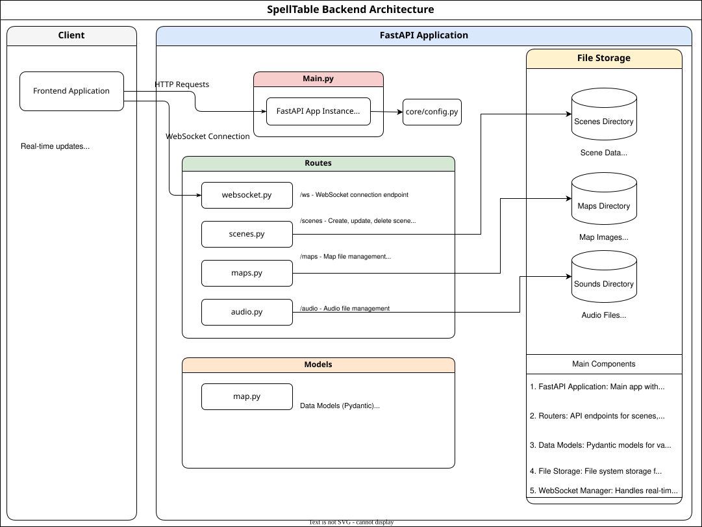

# SpellTable Backend Architecture

## Overview

The SpellTable backend is a FastAPI service that manages game assets (maps, scenes, audio, monsters), campaign data, authentication, and real-time sync between the DM admin UI and player viewers.

Persistence is a mix of:

- **SQLite** (SQLAlchemy; override with `DATABASE_URL`) for users, campaigns, notes, tavern state, and related records
- **Filesystem** storage for maps, scenes, sounds, campaign images, and local monster JSON
- Optional **BYO** Aurora / Fight Club 5e catalogs via env paths (content is never shipped in the repo or default image)

## Flowchart



## Key Components

### 1. Main application (`main.py`)

Entry point that:

- Creates the FastAPI app and CORS middleware
- Registers route modules
- Mounts Socket.IO / Engine.IO for real-time updates
- Runs under Uvicorn (port **8010** by default)

### 2. Core (`app/core/`)

- `config.py` — app factory, CORS, shared settings
- `database.py` — SQLAlchemy engine / session
- `auth.py` — JWT auth and password hashing
- `logging.py` — loguru setup
- `connection_manager.py` — live client connection tracking

### 3. API routes (`app/routes/`)

| Module | Owns |
|--------|------|
| `auth.py` | Login, JWT tokens, user management |
| `campaigns.py` | Campaign CRUD and membership |
| `campaign_notes.py` | Per-campaign markdown notes |
| `campaign_images.py` | Campaign image gallery |
| `campaign_tavern.py` | Optional tavern / business tracking |
| `maps.py` | Map upload, folders, ordering, metadata |
| `scenes.py` | Scene save/load, folders, scene images |
| `audio.py` | Soundboard files and playback control |
| `websocket.py` | Socket.IO events; broadcasts scene / board state |
| `monsters.py` | Local monster library + Aurora/FC5 catalog APIs |
| `spells.py` | Optional Aurora spell autocomplete |
| `backup.py` | Admin export / restore of campaign-related data |

Prefer `/docs` (OpenAPI) for exact paths and schemas; they change more often than this list.

### 4. Services (`app/services/`)

| Service | Role |
|---------|------|
| `monster_service.py` | Local JSON monster library on disk |
| `aurora_monster_catalog.py` | Optional Aurora creatures (`AURORA_ELEMENTS_ROOT`) |
| `aurora_spell_catalog.py` | Optional Aurora spell names/levels |
| `fc5_monster_catalog.py` | Optional Fight Club 5e XML bestiary (`FC5_ROOT`) |
| `hit_dice_service.py` | Hit-dice / HP helpers for rolled enemies |

Catalog XML/content is personal/BYO only (gitignored). Public clones run without Aurora or FC5. See the [root README](../README.md) for compose wiring (`docker-compose.aurora.example.yml`, `FC5_ROOT`).

### 5. Models (`app/models/`)

SQLAlchemy models for DB entities (users, campaigns, etc.) and Pydantic models for request/response validation (maps, scenes, folders, API payloads).

### 6. File storage

Typical directories (also mounted in Docker Compose):

- **Maps** — map images and per-folder order metadata
- **Scenes** — JSON scene files and related assets
- **Sounds** — soundboard audio
- **Campaign images** — gallery uploads
- **Monsters** — local monster JSON library
- **Logs** — rotated application logs

## Data flow

1. **HTTP API** — frontend calls REST endpoints; backend reads/writes DB and filesystem; JSON responses returned to the client.
2. **Real-time** — Socket.IO broadcasts board/scene changes so admin and `/viewer` stay in sync; connection lifecycle is handled in `websocket.py` / `connection_manager.py`.

## Technology stack

- **FastAPI** + **Uvicorn**
- **Pydantic** v2
- **SQLAlchemy** + SQLite by default
- **python-socketio** / Engine.IO for real-time sync
- **JWT** (`python-jose`) and **passlib** / **bcrypt** for auth
- **loguru** for logging
- **uv** for dependency management (`pyproject.toml` / `uv.lock`)

## Deployment

Run as a self-contained service on port **8010**. Docker Compose is documented in the [root README](../README.md). For optional Aurora elements, use `docker-compose.aurora.yml` (from the example file) alongside the main compose file.

## Logging

The application uses [loguru](https://github.com/Delgan/loguru). Configuration lives in `app/core/logging.py` and runs at startup.

### Log levels

- `DEBUG` — detailed diagnostics
- `INFO` — normal operation
- `WARNING` — unexpected but recoverable
- `ERROR` — a function failed
- `CRITICAL` — process may not continue

### Log destinations

1. **Console** — INFO and above, colored
2. **Log files** — DEBUG and above under `logs/`, with daily rotation

### Usage

```python
from loguru import logger

logger.debug("Debug message")
logger.info("Info message")
logger.warning("Warning message")
logger.error("Error message")
logger.critical("Critical message")
```

The logs directory is gitignored.
